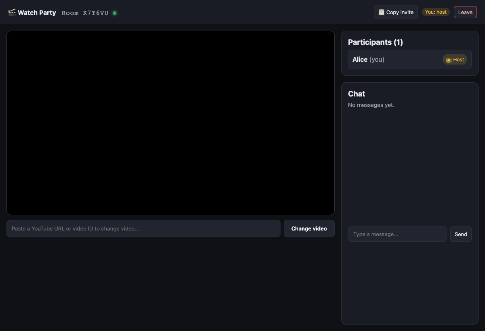
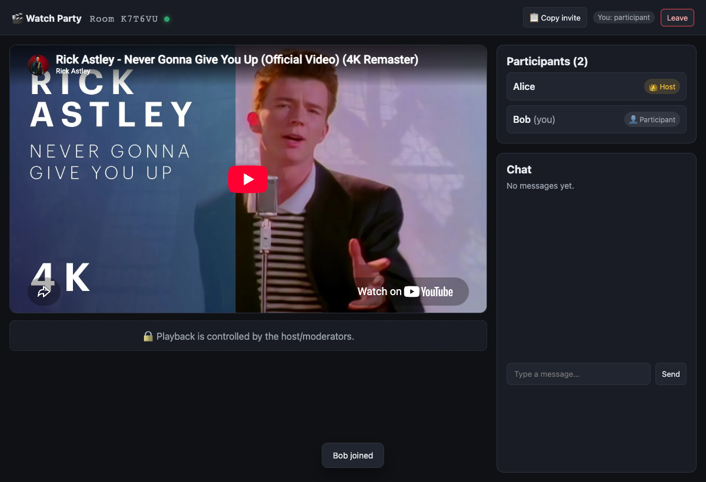
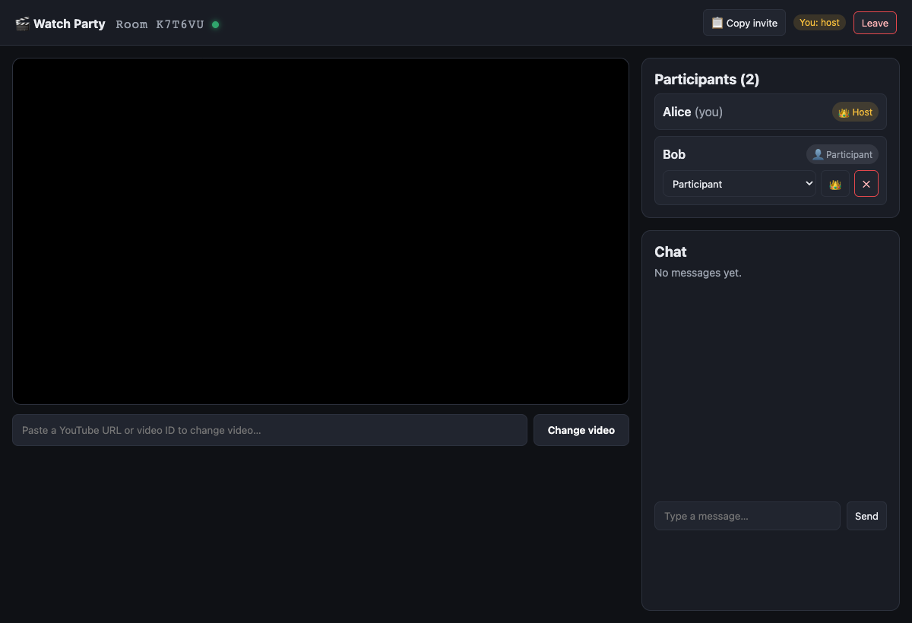
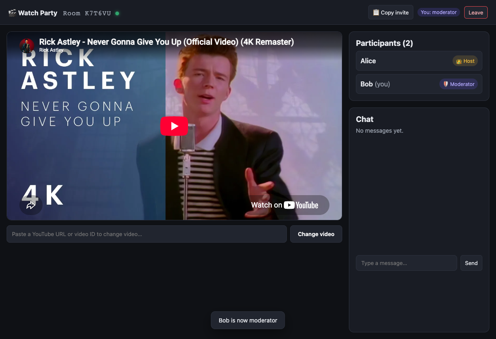

# 🎬 YouTube Watch Party

Watch YouTube videos together in perfect sync. Create a room, share the code,
and everyone's player mirrors the host's play / pause / seek / video changes in
real time — with **role-based access control** enforced on the server.

> Built for the Full-Stack assignment. Runs fully locally; deployment-ready for
> Render/Railway (see [Deployment](#deployment)).

**Live URL:** _not deployed yet — run locally with the steps below._

---

## Features

- ✅ **Real-time sync** — play / pause / seek / change-video propagate to all participants
- ✅ **Rooms** — create or join via a 6-character code / shareable link
- ✅ **WebSockets** — Socket.IO bidirectional channel; server is the source of truth
- ✅ **YouTube IFrame API** — embedded, controllable, feedback-loop-guarded player
- ✅ **Role-Based Access Control** — Host / Moderator / Participant / Viewer, **enforced on the backend**
- ✅ **Host capabilities** — assign roles, remove participants, **transfer host**
- ✅ **Host capability** — only the creator (or an explicitly transferred host) can hold host authority
- ✅ **Persistence** — room/video state persists when deployed with durable storage
- ✅ **Text chat** (bonus)
- ✅ **OOP server** (bonus) — `Room`, `Participant`, `RoomManager`, `MessageHandler` classes
- ✅ **33 automated tests** (unit + live-socket integration)

## Tech Stack

| Layer | Choice |
|-------|--------|
| Frontend | React + TypeScript + Vite |
| Backend | Node.js + Express |
| Realtime | Socket.IO |
| Database | SQLite (`better-sqlite3`) |
| Video | YouTube IFrame Player API |

## Architecture

Clients are dumb renderers; the server holds each room's authoritative video
state and broadcasts it. RBAC is checked in the `MessageHandler` **before** any
mutation or broadcast, so a hacked client cannot control a room it lacks
permission for.

Full write-ups: **[docs/HLD.md](./docs/HLD.md)** · **[docs/LLD.md](./docs/LLD.md)**

```
Browser (React + YT IFrame) ⇄ Socket.IO ⇄ Node server
                                              │ MessageHandler (RBAC gate)
                                              │ RoomManager → Room → Participant
                                              └ SQLite (rooms + video state)
```

---

## Getting Started (local)

**Prerequisites:** Node.js ≥ 20.

### 1. Backend

```bash
cd server
npm ci
npm run dev            # http://localhost:4000  (or: npm run build && npm start)
```

### 2. Frontend

```bash
cd client
npm ci
npm run dev            # http://localhost:5173
```

Open **http://localhost:5173**, enter a name, click **Create a room**, then open
the copied invite link in a second browser window to see live sync. The Vite dev
server proxies `/api` and the WebSocket to the backend on `:4000`.

### 3. Try it

1. Window A: create a room, paste a YouTube URL, press play/seek.
2. Window B: open the invite link → the video mirrors A in real time.
3. Window B is a **Participant** — its controls are locked.
4. In Window A's participant list, promote B to **Moderator** → B can now control playback.
5. Try **remove** or **transfer host** from A's roster.

## Testing

```bash
cd server
npm test               # 33 tests: unit + live-socket integration
```

The integration suite boots a real Socket.IO server and drives it with real
client connections — proving sync and RBAC over the wire.

### Live end-to-end demo

With the backend running (`npm run dev` in `server/`):

```bash
cd server
node scripts/demo.mjs http://localhost:4000
```

Prints an annotated walkthrough: room creation, join/roles, play/seek/
change-video sync, **RBAC rejection**, promote-to-moderator, chat, transfer-host,
and removal. See
[docs/RESULTS.md](./docs/RESULTS.md) for captured output.

## Screenshots

| Host view (full controls) | Participant view (locked) |
|---|---|
|  |  |

| Host managing a participant | Promoted to moderator |
|---|---|
|  |  |

## Configuration

| Var | Default | Purpose |
|-----|---------|---------|
| `PORT` | `4000` | backend port |
| `CORS_ORIGIN` | `http://localhost:5173` in development | exact allowed frontend origin(s), comma-separated; **required in production** |
| `DB_FILE` | `./data/watchparty.db` | SQLite file (`:memory:` = ephemeral) |
| `VITE_SERVER_URL` | `""` (dev proxy) | client → backend origin in prod builds |

When a room is created, the server returns a random host capability. The browser
stores it in `sessionStorage`; it is never put in the invite URL. Do not clear
browser session data if you need to retain host access. Host transfer rotates
the capability and gives it only to the new host.

## Deployment

This implementation is intentionally a **single backend instance**. It uses an
in-memory room registry and SQLite, so do not enable horizontal scaling. For
multi-instance deployment, migrate room data to a managed database and add a
Socket.IO adapter such as Redis.

1. Create a **Backend Web Service** from `server/` with build command
   `npm ci && npm run build` and start command `npm start`.
2. Set `NODE_ENV=production`, `CORS_ORIGIN=https://your-frontend-domain`, and
   `DB_FILE` to a path on a persistent volume, for example
   `/var/data/watchparty.db`. Never use `*` for `CORS_ORIGIN`.
3. Attach a persistent disk/volume to that same path. Without it, SQLite data
   is lost on restart. Configure regular backups for the volume.
4. Create a **Frontend Static Site** from `client/` with build command
   `npm ci && npm run build`, publish directory `dist`, and build variable
   `VITE_SERVER_URL=https://your-backend-domain`.
5. Confirm HTTPS, WebSocket connectivity, `/api/health`, and cross-origin
   requests in a staging environment before publishing the public URL.

Add the resulting public URL to the top of this README.

## What I'd explain in a walkthrough

- **Socket.IO** provides rooms, acks, reconnection, and a clear future adapter path for scale.
- **WebSockets** give a persistent duplex channel so state changes push instantly instead of polling.
- **RBAC** is one permission matrix consulted in the per-socket `MessageHandler` before every mutation.
- **YouTube IFrame** sync avoids feedback loops via a suppression guard and a drift threshold.
- **Security**: host authority is a server-issued capability; inputs, HTTP requests, and socket actions are bounded and rate-limited.
